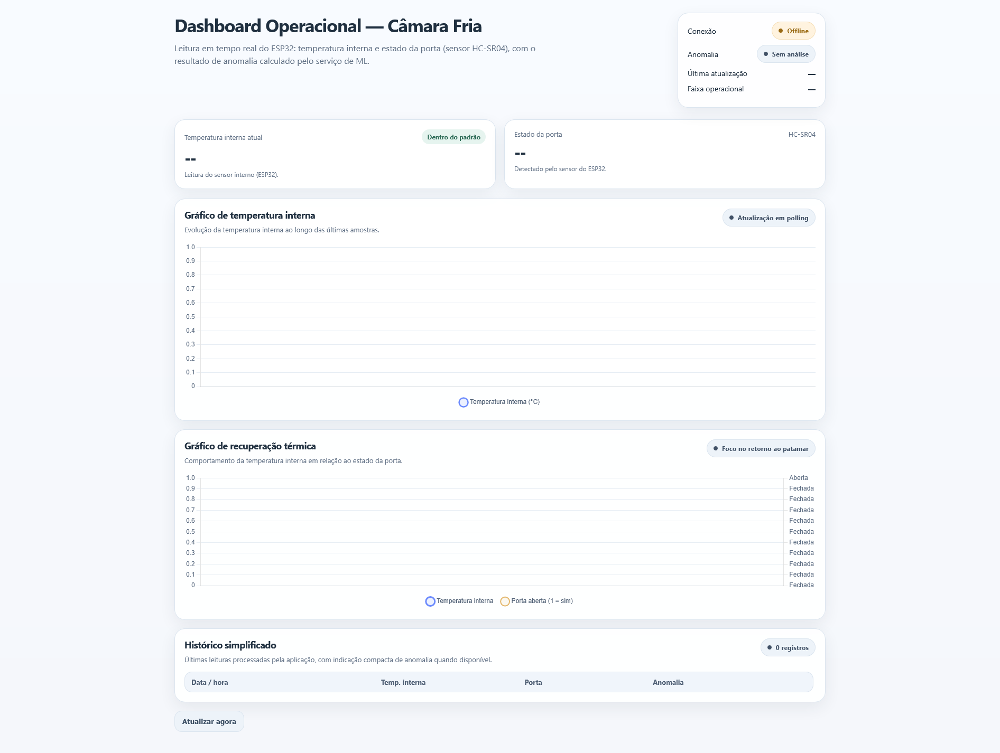

# Sistema de Monitoramento Inteligente de Câmara Fria

> Monitoramento IoT em tempo real com detecção de anomalias via Isolation Forest.

---

## 📌 Visão Geral

O presente repositório implementa um sistema de monitoramento IoT para câmaras frias. Um ESP32 com sensor DS18B20 (temperatura) e sensor HC-SR04 (estado da porta) coleta leituras e envia os dados para uma API FastAPI, que aplica um modelo de Machine Learning (Isolation Forest) para classificar o estado da câmara em tempo real. Uma dashboard web exibe o estado consolidado a partir dos dados reais recebidos do dispositivo.

### Funcionalidades

- Ingestão de dados via ESP32 (DS18B20 + HC-SR04)
- Detecção de anomalias com Isolation Forest treinado para a faixa operacional real da câmara (-4°C a 1°C)
- 5 features contextuais calculadas em tempo real a partir da série temporal de temperatura: `temp_interna`, `media_movel_2min`, `desvio_padrao_5min`, `taxa_variacao_min`, `porta_aberta`
- Filtro de persistência: alerta só é disparado após N leituras consecutivas classificadas como anômalas/suspeitas
- Dashboard single-page somente leitura (sem controles manuais)
- Simulador Python para testes sem o hardware físico

---

## 🏗️ Arquitetura

```text
┌──────────────┐     POST /esp32/reading      ┌──────────────────────┐
│   ESP32      │ ────────────────────────────▶│                      │
│  DS18B20 +   │  {temp_interna, door_state}   │   API FastAPI        │
│  HC-SR04     │                                │   (Uvicorn)          │
└──────────────┘                                │                      │
                                                 │   ┌──────────────┐   │
┌──────────────┐                                │   │  ML Service  │   │
│  Dashboard   │ ◀── GET /dashboard/current ────│   │  (IF Model)  │   │
│  (HTML/JS)   │                                │   └──────────────┘   │
└──────────────┘                                └──────────────────────┘

┌──────────────┐
│  Simulador   │ ─── POST /esp32/reading ──────▶ (mesma rota acima)
│  (Python)    │
└──────────────┘
```

---

## 📁 Estrutura do Projeto

```text
sistema-monitoramento-camara-fria/
├── README.md
├── .gitignore
│
├── api/
│   ├── requirements.txt
│   └── app/
│       ├── main.py
│       ├── core/
│       │   └── config.py
│       ├── api/
│       │   └── routes.py
│       ├── schemas/
│       │   └── payloads.py
│       ├── services/
│       │   ├── data_service.py
│       │   └── ml_service.py
│       └── model/
│           └── isolation_forest_model.joblib
│
├── firmware/
│   └── main.ino
│
├── frontend/
│   └── dashboard.html
│
├── ml/
│   └── IsolationForest.ipynb
│
└── simulador/
    └── simulator.py
```

> Nota: `llm_service.py` foi removido — não há mais integração com LLM neste sistema.

---

## 📸 Screenshot da Dashboard

### Visão Geral



---

## 🤖 ML — Treinamento e Deploy do Modelo

O notebook `ml/IsolationForest.ipynb` gera o modelo consumido pela API.

### 1. Instalar as dependências

```bash
pip install joblib scikit-learn pandas numpy matplotlib seaborn
```

### 2. Executar o notebook

O notebook deve gerar um dataset de treino calibrado para a faixa operacional real da câmara fria (**-4°C a 1°C**), aplicar a mesma engenharia de features usada em produção pelo `ml_service.py`, treinar um `Pipeline` de Isolation Forest sobre as amostras normais e salvar o resultado em `isolation_forest_model.joblib`.

### 3. Copiar o modelo para a API

Após o treinamento, coloque o arquivo em:

```text
api/app/model/isolation_forest_model.joblib
```

A API carrega automaticamente esse arquivo ao iniciar via `ml_service.py`. Caso o modelo não esteja disponível, o sistema opera em modo de fallback utilizando heurísticas simples (`_mock_evaluation`).

### Features utilizadas pelo modelo

As features são calculadas em tempo real pelo `ml_service.py`, a partir de janelas deslizantes sobre a série de temperatura interna e do estado da porta recebido em cada leitura:

| Feature | Descrição |
|---|---|
| `temp_interna` | Temperatura interna da câmara (°C), lida via DS18B20 |
| `media_movel_2min` | Média móvel de temperatura sobre os últimos 2 minutos (24 leituras) |
| `desvio_padrao_5min` | Desvio padrão da temperatura sobre os últimos 5 minutos (60 leituras) |
| `taxa_variacao_min` | Taxa de variação de temperatura por minuto |
| `porta_aberta` | Estado binário da porta (0 = fechada, 1 = aberta), lido via HC-SR04 |

Além da classificação (`normal` / `suspeita` / `anômala`), o serviço aplica um filtro de persistência: só sinaliza alerta após `N_PERSISTENCIA` (6) leituras consecutivas anômalas/suspeitas, a um intervalo de leitura de 5 segundos.

---

## 🚀 Rodando o Projeto

### Pré-requisitos

- Python 3.11+
- ESP32 com sensores DS18B20 e HC-SR04 (ou utilize o simulador)

### 1. API

```bash
cd api
pip install -r requirements.txt
uvicorn app.main:app --reload --host 0.0.0.0 --port 8000
```

A API estará disponível em `http://localhost:8000`.

Documentação: `http://localhost:8000/docs`

### 2. Dashboard

Abra diretamente no navegador:

```bash
# Linux / macOS
xdg-open frontend/dashboard.html

# Windows
start frontend/dashboard.html
```

Ou sirva com qualquer servidor estático. A dashboard é somente leitura.

### 3. Simulador

```bash
cd simulador
pip install requests
python simulator.py
```

O simulador foi atualizado para o contrato atual da API: envia leituras de temperatura interna na faixa operacional de treino do modelo (-4°C a 1°C) e simula localmente o estado da porta (`door_state`), alternando entre `open`/`closed` a cada ciclo, sem depender de nenhuma rota de configuração externa.

### 4. Firmware

Edite as constantes em `firmware/main.ino`:

```cpp
const char* WIFI_SSID     = "SEU_WIFI";
const char* WIFI_PASSWORD = "SUA_SENHA";
const char* API_URL       = "http://SEU_IP:8000/api/v1/esp32/reading";
```

O firmware deve enviar `temperature_internal` (DS18B20) e `door_state` (`"open"` ou `"closed"`, derivado da leitura do HC-SR04) a cada ciclo. Compile utilizando Arduino IDE.

---

## 🔌 Endpoints da API

| Método | Rota | Descrição |
|---|---|---|
| `POST` | `/api/v1/esp32/reading` | Recebe leitura do dispositivo (`device_id`, `temperature_internal`, `door_state`) |
| `GET` | `/api/v1/dashboard/current` | Retorna o estado consolidado mais recente (404 se ainda não houver leitura) |

> As rotas `/api/v1/dashboard/simulate` e `/api/v1/analysis/llm` foram removidas. Não há mais simulação de ambiente externo nem análise por LLM.

### Exemplo

```bash
curl -X POST http://localhost:8000/api/v1/esp32/reading \
  -H "Content-Type: application/json" \
  -d '{"device_id":"esp32-01","temperature_internal":-1.5,"door_state":"closed"}'
```

---

## 🛠️ Tecnologias

| Camada | Tecnologia |
|---|---|
| Hardware | ESP32 + DS18B20 + HC-SR04 |
| Firmware | Arduino (C++) |
| Backend | FastAPI + Uvicorn + Pydantic |
| ML | scikit-learn (Isolation Forest + StandardScaler) + joblib |
| Frontend | HTML + Vanilla JS + Chart.js |
| Simulador | Python + Requests |

---

## 📄 Licença

Este projeto está disponível para fins acadêmicos e de pesquisa.